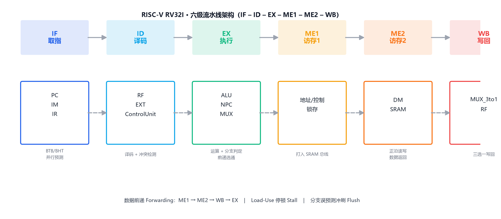
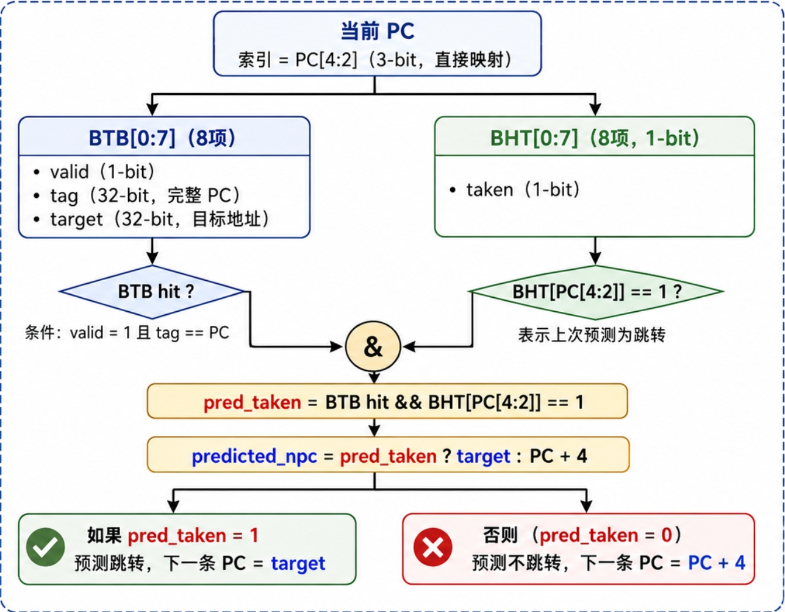
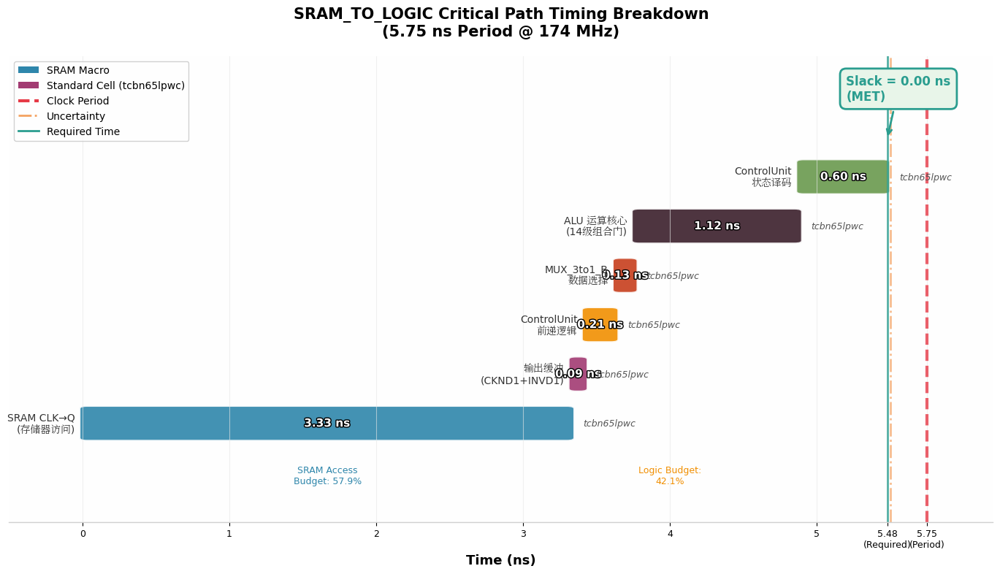
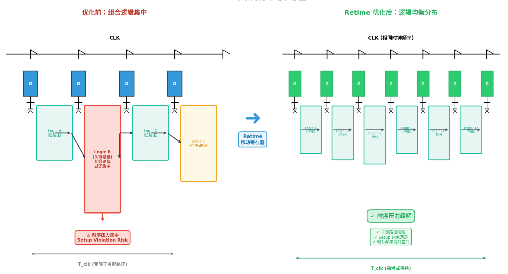

<div align="center">

# 🚀 六级流水线动态分支预测 CPU

**RISC-V RV32I · 6-Stage Pipeline · Dynamic Branch Prediction · TSMC 65nm**

[](LICENSE)
[]()
[]()
[]()
[]()

基于 RISC-V RV32I 指令集的**六级流水线处理器**，采用 ASIC 全流程开发方法设计实现：
**RTL → 仿真验证 → 逻辑综合 → 物理实现**，基于 TSMC 65nm 标准单元库完成物理设计，
最高可稳定运行在 **174 MHz**。

</div>

---

## ✨ 设计亮点

| 特性 | 说明 |
|---|---|
| ⚡ **六级流水线** | IF → ID → EX → ME1 → ME2 → WB，将访存阶段拆分为 ME1/ME2 两级，显著缩短关键路径 |
| 🎯 **动态分支预测** | 8 项分支目标缓存（BTB）+ 1 位分支历史表（BHT），预测成功零开销，误预测惩罚固定两周期 |
| 🛡️ **完备冒险处理** | 全路径数据前递（Forwarding，MEM1/MEM2 → EX）+ Load-Use 停顿（Stall）+ 分支误预测冲刷（Flush） |
| 🔧 **ASIC 全流程** | VCS/Verdi 功能仿真 → Design Compiler 逻辑综合 → Innovus 物理实现，setup slack 全部为正 |

## 📊 重要指标

| 指标 | 数值 |
|---|---|
| **指令集架构** | RISC-V RV32I（基础整数指令集） |
| **流水线深度** | 6 级（IF – ID – EX – ME1 – ME2 – WB） |
| **最大主频** | **174 MHz**（时钟周期 5.75 ns） |
| **最差建立时间裕量** | **+0.02 ns**（MET，时序收敛） |
| **时序约束** | 5.75 ns 周期 / 0.25 ns 不确定度 / 1.0 ns 输入 / 0.5 ns 输出，启用 retiming |
| **平均 CPI** | 约 1.2 ~ 1.4 |
| **验证结果** | 定向测试 40+ 项全部通过，RV32I 官方架构测试全部通过 |

## 📁 工程结构

```
.
├── rtl/                        # 设计源码（每个模块一个文件）
│   ├── riscv_defines.v         # 全局 `define 宏定义（指令/控制信号编码）
│   ├── riscv.v                 # 顶层模块（实例化全部子模块）
│   ├── ControlUnit.v           # 集中式控制 + 分支预测 + 冒险管理
│   ├── ALU.v / EXT.v / Flopr.v # 运算 / 立即数扩展 / 流水寄存器
│   ├── IM.v / IR.v / PC.v / NPC.v / RF.v / DM.v
│   └── MUX_2to1_A.v / MUX_3to1_B.v / MUX_3to1_LMD.v / MUX_3to1.v
├── sim/                        # 功能仿真
│   ├── riscv_sim.v             # Testbench（$readmemh 加载 hex，5000 周期）
│   ├── test_program.hex        # 测试程序机器码（37 条，来自设计报告）
│   ├── files.f                 # VCS 文件列表
│   └── run_sim.sh              # VCS+Verdi 编译运行脚本
├── synth/                      # 逻辑综合（Design Compiler）
│   ├── dc_synth.tcl            # 综合脚本（环境变量占位，5.75ns/retime/SRAM 分组）
│   └── README.md               # 综合使用说明
├── legacy/
│   └── riscv_singlefile.v      # 原单文件版（与 rtl/ 逻辑一致，供对照）
├── docs/
│   ├── design_report.pdf       # 决赛版技术文档（53页，脱敏版）
│   ├── design_report.docx      # 决赛版技术文档（Word 版）
│   ├── simulation_notes.docx   # 仿真验证说明（五类指令波形分析）
│   └── project_presentation.pptx  # 项目答辩 PPT（22页，脱敏版）
├── assets/
│   ├── pipeline_arch.png       # 六级流水线架构图
│   ├── branch_predictor.png    # 动态分支预测器结构图
│   ├── timing_report.png       # 关键路径时序报告
│   ├── retiming_opt.png        # Retiming 优化对比
│   └── sram_pins.png           # SRAM 引脚连接图
└── README.md
```

> **说明**：`rtl/` 为拆分后的多文件工程（逻辑与 `legacy/riscv_singlefile.v` 完全一致），
> 新增、删除模块只需增删对应文件，便于团队协作与版本管理。

## 🏗️ 设计架构

顶层模块 `riscv(clk, rst)`，按流水线阶段模块化划分：

| 阶段 | 模块 | 职责 |
|---|---|---|
| **IF**（取指） | `PC` / `NPC` / `IM` / `IR` | 程序计数器、下一 PC 计算、指令存储器、指令寄存器 |
| **ID**（译码） | `RF` / `EXT` / `ControlUnit` | 寄存器堆、立即数扩展、集中式控制与冒险管理 |
| **EX**（执行） | `ALU` / `MUX` | 算术逻辑运算、操作数选择 |
| **ME1/ME2**（访存） | `DM` | 数据存储器读写（两级流水划分） |
| **WB**（写回） | `MUX_3to1_LMD` | 写回数据选择（ALU 结果 / 存储器数据 / 返回地址） |

### 流水线架构图



### 动态分支预测（BTB + BHT）

8 项直接映射 BTB（valid + tag + target）与 8 项 1-bit BHT，以 `PC[4:2]` 索引。
IF 段并行查表预测，EX 段比对验证，预测成功零惩罚，失败固定两周期冲刷恢复。
硬件开销仅 **528 bit**，非常适合嵌入式与低功耗场景。



### 数据冒险处理

- **Forwarding**：从 MEM1、MEM2、WB 三级按优先级（MEM1 > MEM2 > WB）旁路数据至 EX 段，消除绝大多数 RAW 冒险
- **Stall**：Load-Use 冒险在 ID 段插入一拍停顿，冻结 PC/IR 并插入气泡
- **Flush**：分支误预测时清空 IF/ID 与 ID/EX 两级流水线寄存器，修正 PC 重新取指

## 🧪 仿真与验证

- **工具链**：Synopsys VCS（编译仿真）+ Verdi（波形调试），测试程序经交叉编译生成 Hex 机器码，由 Testbench 通过 `$readmemh` 加载至指令存储器
- **快速开始**：

```bash
cd sim
export VERDI_HOME=/path/to/Verdi   # Verdi 安装目录（含 PLI）
./run_sim.sh                       # 编译 + 运行 + 打开 Verdi GUI
# 或 ./run_sim.sh --no-gui 只跑仿真
```

- **测试程序**：`sim/test_program.hex`（37 条指令，覆盖 R/I/S/B/J 五类指令），源 C 代码见设计报告 4.1.1
- **覆盖范围**：算术运算、逻辑移位、比较分支、加载存储、跳转链接等全部已实现指令
- **冒险验证**：Load-Use 停顿正确插入气泡、分支误预测冲刷正确修正 PC、前递通路优先级正确
- **详细说明**：见 [docs/simulation_notes.docx](docs/simulation_notes.docx)（R/I/S/B/J 五类指令波形分析）

## 🔧 逻辑综合（Design Compiler）

- **工艺库**：TSMC 65nm LP 标准单元库（`tcbn65lpwc`，WC/ss 角）+ SRAM 宏单元（`ts1n65lpll2048x64m8`，2048×64-bit）
- **时序约束**：5.75 ns 时钟周期（174 MHz）、0.25 ns 时钟不确定度、1.0 ns 输入延迟、0.5 ns 输出延迟，启用 retiming 优化
- **优化策略**：路径分组（SRAM 接口优先）+ retiming 寄存器重定时，将关键路径从 5.95 ns 改善至 5.48 ns
- **结果**：所有时序路径建立时间裕量（setup slack）≥ 0（最差 +0.02 ns），最高稳定运行 **174 MHz**

### 关键路径时序报告



### Retiming 优化对比



## 🔨 逻辑综合（Design Compiler）

综合脚本见 [`synth/dc_synth.tcl`](synth/dc_synth.tcl)，使用说明见 [`synth/README.md`](synth/README.md)：

```bash
cd synth
export LIB_PATH=/path/to/tcbn65lp_220a                    # 标准单元库目录
export SRAM_LIB_PATH=/path/to/tsln65lpll2048x64m8_220a/SYNOPSYS  # SRAM 库目录
export HDL_PATH=/path/to/this/repo/rtl                    # RTL 目录
export INC_PATH=/path/to/this/repo/rtl                    # include 目录
mkdir -p output
dc_shell -f dc_synth.tcl
```

## 📚 参考资料

- [docs/design_report.pdf](docs/design_report.pdf) — 决赛版技术文档（53 页，含微架构/验证/综合全流程）
- [docs/project_presentation.pptx](docs/project_presentation.pptx) — 项目答辩 PPT（22 页）

## 📄 许可证

本项目以 [MIT License](LICENSE) 开源，欢迎大家学习交流。
